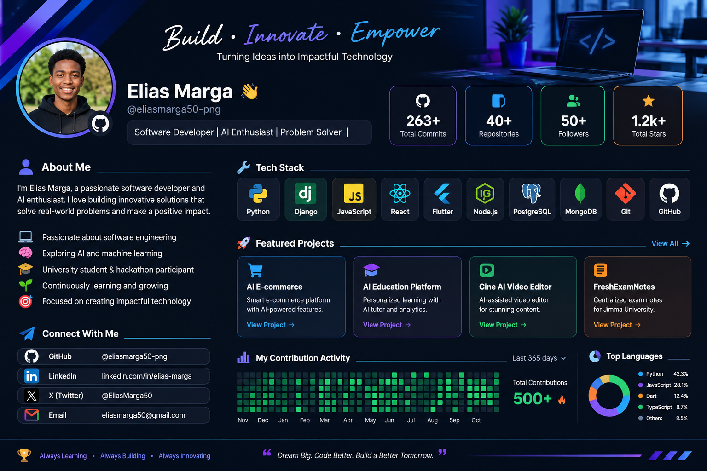

<!-- ================= HERO SECTION ================= -->

 

 

### Software Developer | AI Enthusiast | Problem Solver

*Turning ideas into impactful technology.*

---

<!-- ================= ABOUT ME ================= -->

## 👨‍💻 About Me

Hi, I'm **Elias Merga** 👋

I'm a passionate software developer and university student who enjoys
building practical software solutions that solve real-world problems.

- 🚀 Building AI-powered applications
- 🤖 Exploring Artificial Intelligence and Machine Learning
- 🌐 Developing full-stack web applications
- 📱 Building mobile applications with Flutter
- 🧠 Continuously improving my software engineering skills
- 🎯 Interested in technology that creates meaningful impact

> I believe great software starts with understanding real problems.

---

<!-- ================= TECH STACK ================= -->

## 🛠️ Tech Stack

### Languages

### Frameworks & Development

### Databases & Tools

---

<!-- ================= GITHUB STATS ================= -->

## 📊 GitHub Analytics

 

---

<!-- ================= PROJECTS ================= -->

## 🚀 Featured Projects

### 🎓 AI Education Platform

An AI-powered educational platform designed to improve
learning through personalized educational experiences.

- AI-powered learning assistance
- Student authentication
- Personalized learning experience

### 🛒 AI E-commerce

An intelligent e-commerce application designed to provide
a modern online shopping experience.

- Product management
- Shopping cart and order management
- AI-powered features

### 🎬 Cine AI

An AI-assisted video editing application focused on
simplifying video editing and content creation.

- AI-assisted editing workflow
- Video processing
- Content creation experience

---

<!-- ================= CONTRIBUTIONS ================= -->

## 📈 Contribution Activity

---

<!-- ================= CONNECT ================= -->

## 🌐 Connect With Me

---

<!-- ================= FOOTER ================= -->

### 💡 Always Learning. Always Building. Always Innovating.

*Dream Big. Code Better. Build a Better Tomorrow.*

