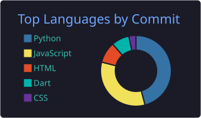

<!-- ================= INTRODUCTION ================= -->

# Hey 👋, Welcome to My GitHub Zone!

---

## 👨‍💻 About Me

- 🤖 AI-Powered Full-Stack and Mobile App Developer
- 🚀 Building intelligent web applications and AI-powered solutions
- 🧠 Exploring Artificial Intelligence
- 🎓 University student passionate about real systems
- 🌱 Always learning, building, and improving
- 🤝 Open to collaboration and innovative ideas

---

## 🛠️ Tech Stack & Technologies

### Programming Languages

### Frameworks & Libraries

### Databases & Tools

---

## 📊 GitHub Statistics

<table>
<tr>
<td align="center">

### Most Used Languages

</td>
<td align="center">

### Contribution Streaks

</td>
</tr>
</table>

---

## 🌐 Let's Connect!

---

### ⚡ Always Learning • Always Building • Always Innovating

*"The best way to learn faster is just keep suffering."*

